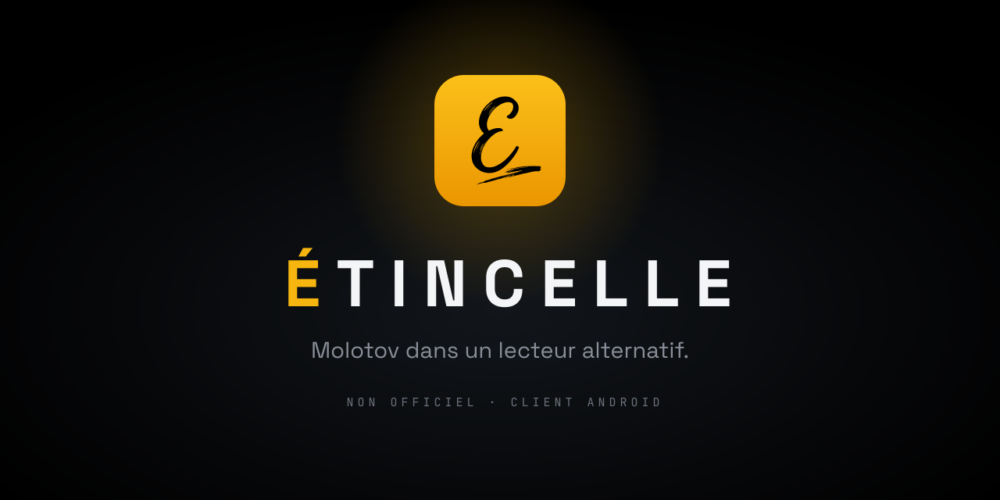
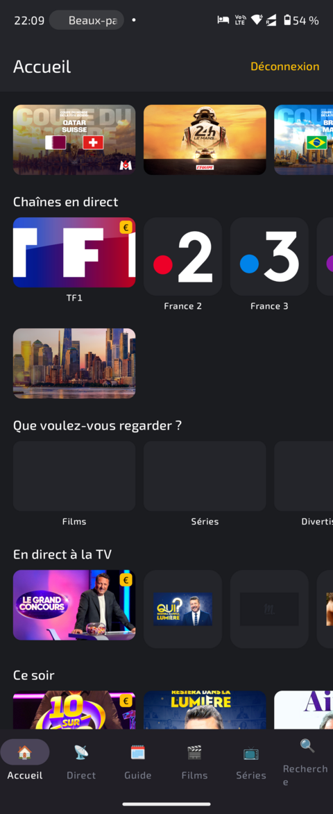
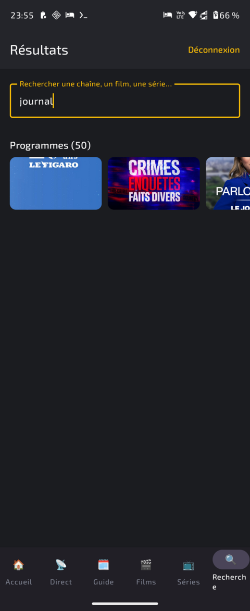

<div align="center">



[](LICENSE)
-3DDC84?logo=android&logoColor=white)


[](https://github.com/renaudallard/etincelle/releases)
[](https://www.paypal.me/RenaudAllard)

</div>

**etincelle** est une application Android native pour regarder **Molotov** sur **téléphone**, **tablette**
et **Android TV**. Elle passe par le backend **Fubo** qu'utilise l'application Molotov actuelle (5.51),
reprend l'apparence de l'ancienne interface Molotov **4.27** sur un fond **noir pur** (les pixels d'un
écran OLED restent éteints), avec des **boutons en relief** qui s'enfoncent à l'appui, et lit les
contenus sur l'appareil avec le **DRM Widevine** d'AndroidX Media3.

> [!WARNING]
> Projet non officiel, sans aucune affiliation avec Molotov ni Fubo. **etincelle** n'est qu'un client
> alternatif : il n'offre aucun accès gratuit, ne partage aucun compte et ne contourne aucune
> protection.
>
> - **Aucun contournement de géo-restriction.** L'application n'embarque ni VPN, ni proxy, ni aucun
>   moyen de masquer ou de falsifier votre localisation. Le backend reste géo-restreint à l'Union
>   européenne : hors de l'UE, le service ne fonctionne pas, et etincelle ne vous aidera d'aucune
>   façon à le débloquer.
> - **Aucun accès sans compte.** Regarder Molotov exige votre propre compte payant valide avec
>   l'option **Molotov Extra** sur Fubo. L'application ne fournit aucun identifiant et ne permet
>   strictement pas de regarder Molotov sans cet abonnement.
>
> Vous restez seul responsable du respect des conditions d'utilisation de Molotov/Fubo et de la
> législation applicable.

**Sommaire** : [Fonctionnalités](#fonctionnalités) · [Captures d'écran](#captures-décran) ·
[Installation](#installation) · [Architecture du projet](#architecture-du-projet) ·
[Construction](#construction) · [Licence](#licence)

## Fonctionnalités

En bref :

- **Direct**, **guide des programmes** sur 24 heures, **recherche**, **rattrapage** et **VOD**.
- Un direct qui se **rembobine** sur toute la durée du programme, avec **Regarder depuis le début**.
- **Passer la pub** sur la plupart des chaînes, à la demande ou tout seul.
- **Enregistrements** d'un épisode ou d'une série entière.
- Diffusion vers un **Chromecast**, et **application TV** pilotée depuis le téléphone.
- **Profils** du compte, **chaînes favorites**, **recherche vocale**.
- **Mises à jour** depuis GitHub, automatiques si vous le souhaitez.

### Le direct

- La barre de progression épouse le **programme regardé**, du début à la fin de sa diffusion, ses
  heures affichées aux extrémités. En différé, elle suit le programme où l'on se trouve, et couvre
  toute la fenêtre de rembobinage là où le guide ne sait plus ce qui passait.
- Tant que le guide ne donne que l'heure prévue d'un programme (une heure ronde, parfois à quelques
  minutes près), il est redemandé chaque minute pendant un quart d'heure, et la barre prend l'heure
  réelle dès qu'il la connaît.
- Le bord du direct se situe en cours de route, la portion pas encore diffusée formant la fin de la
  barre ; la partie trop ancienne pour être rembobinée est tracée dans une couleur distincte.
- **Revenir au direct** apparaît dès que l'on s'éloigne du bord. Sur le téléviseur, il s'affiche avec
  les commandes du lecteur et s'atteint avec la flèche **Haut**.
- Sur le téléviseur, commandes masquées, **Gauche** et **Droite** reculent de 10 s et avancent de
  30 s, de plus en plus vite quand on les maintient. La barre et l'heure d'arrivée s'affichent le
  temps de choisir, et les appuis s'additionnent en un seul déplacement. Comme sur le Chromecast, un
  recul s'arrête au début de l'émission en cours ; un nouvel appui sur **Gauche** recule plus loin.
- Sur la fiche d'une chaîne en direct, **Regarder depuis le début** reprend le programme en cours à
  son vrai commencement, l'heure que donne le guide et non l'horaire prévu, dans la limite de la
  fenêtre de rembobinage. **Regarder le replay** lit ce même programme en entier quand il est aussi
  disponible à la demande.

### Passer la pub

En différé, dans une coupure publicitaire, un bouton **Passer la pub** mène à sa fin. Sur le
téléviseur, **OK** suffit, ou, les commandes affichées, la flèche **Droite** depuis leur dernier bouton
puis **OK**. Le réglage **Passer les publicités automatiquement**, dans **Paramètres**, le fait sans
rien demander, sauf dans une coupure où l'on est revenu en arrière :

| Réglage | Ce qui est passé tout seul |
|---|---|
| **Non** (par défaut) | rien : le bouton est toujours proposé |
| **Coupures signalées** | les coupures que la chaîne signale : groupes TF1 et France Télévisions exactement, groupe RMC et BFMTV d'après la forme de leurs coupures, ou d'après les publicités que le service place lui-même dans une coupure diffusée pendant qu'on regarde |
| **Signalées et presque sûres** | en plus, les coupures trouvées par les noirs entre les publicités, et celles que le logo de la chaîne désigne sans doute possible |

Les coupures sont trouvées de quatre façons :

- **Signalées dans le flux** (groupes TF1 et France Télévisions, LCI) : exactes. Rien d'autre n'est
  proposé sur ces chaînes, dont les bandes-annonces et parrainages ne se distinguent pas sûrement du
  début de l'émission.
- **Forme du flux** (groupe RMC, BFMTV, longues coupures de la nuit comprises) : exactes.
- **Noirs entre les publicités** (M6, Gulli, Canal J, TIJI, Paris Première, Automoto, Toute
  l'Histoire, AB 1) : l'image est chiffrée, mais pas la taille de chaque image, et la demi-seconde de
  noir entre deux publicités s'y lit. La coupure va du deuxième noir à l'avant-dernier.
- **Logo de la chaîne**, dans les vignettes que le service garde de chaque chaîne (les autres chaînes,
  sauf Arte, qui n'a pas de publicité) : une estimation, qui s'arrête une demi-minute avant le retour
  du logo, 24 secondes pour une coupure presque sûre. Mieux vaut voir les dernières publicités que
  perdre le début de l'émission.

Au direct, il n'y a nulle part où sauter. Dans un **enregistrement**, les coupures sont cherchées à
l'ouverture d'après ses vignettes et ses sous-titres. Sur un **Chromecast**, c'est le récepteur qui les
cherche de la même façon et affiche **Passer la pub : OK**.

Ce que l'application trouve et passe sur chaque chaîne, et les règles en détail, sont dans
[docs/coupures-pub.md](docs/coupures-pub.md).

### Fiches, séries et épisodes

- Cliquer sur un programme ouvre d'abord sa **fiche détaillée** (synopsis, casting, année,
  classification) plutôt que de le lire aussitôt. Elle regroupe ses autres diffusions disponibles.
- Comme dans l'application officielle, la fiche indique au-dessus du titre quand le programme a été
  **diffusé** (« Diffusé: 12 févr. ») ou jusqu'à quand il reste disponible (« Expire dans 6j »), et
  chaque épisode sa date de diffusion (« 07 juin à 13h25 »). Sur le téléviseur, l'image du programme
  occupe le fond de la fiche.
- Les vignettes portent l'épisode (« S16 E6 Agde »), la durée et l'année (« 52m • 2026 ») ou le nombre
  d'épisodes enregistrés, l'étiquette du programme (**REC** pour un enregistrement, l'heure de
  diffusion pour *Ce soir*) et le **logo de la chaîne** qui le propose. Elles gardent la forme de leur
  image : affiches en portrait, images en paysage, logos de chaînes sur un carré.
- Une série en rattrapage liste ses **épisodes disponibles**, avec un **sélecteur de saison** quand
  elle en compte plusieurs. Une série **enregistrée** montre d'abord vos épisodes enregistrés, puis les
  épisodes disponibles.
- À la fin d'un épisode, l'**épisode suivant** s'annonce par un compte à rebours (« Commence dans
  9 s ») puis démarre tout seul, sur le téléphone comme sur le Chromecast, application en arrière-plan
  comprise. **À suivre** le lance aussitôt, **Regarder le générique** laisse l'épisode se terminer. Un
  épisode regardé jusqu'au générique reprend ensuite depuis le début.
- Un programme **pas encore diffusé** indique quand il passera (« Ce programme sera en direct dans
  4 jours. ») au lieu d'un « Regarder » qui échouerait.

### Enregistrements

- Sur la fiche d'une chaîne en direct, le menu **Enregistrer** enregistre **l'épisode** en cours ou
  **la série** entière. La fiche d'une série offre **Enregistrer la série**, qui devient **Arrêter
  d'enregistrer la série** une fois l'enregistrement programmé.
- L'onglet **Enregistrements** (« Enregistrés » sur téléphone) les présente en grille, comme dans
  l'application officielle : une vignette par série indique son nombre d'épisodes et ouvre la liste des
  épisodes enregistrés, avec leur date.
- Un enregistrement se lit depuis le DVR où qu'on l'ouvre : onglet, rangées *Vos enregistrements* de
  l'accueil, des films et des séries, fiche d'une série.
- Les contenus à la demande (rattrapage, VOD, enregistrements) sont mis en **mémoire tampon** plus loin
  à l'avance, selon la mémoire de l'appareil, pour qu'une brève coupure réseau n'interrompe pas la
  lecture.

### Parcourir et chercher

- L'accueil réunit aussi les **applications des diffuseurs** (france.tv, MyTF1, M6+…) pour parcourir
  leur catalogue ; un abonnement peut être requis.
- L'en-tête d'une rangée (par ex. *En direct à la TV*) ouvre la **catégorie complète en grille**, avec
  le nom de la chaîne sous chaque programme et des **icônes de genre**.
- La grille de **toutes les chaînes** (TNT, chaînes thématiques Molotov…) s'ouvre avec l'onglet
  **Chaînes** sur la TV, et sur téléphone avec **Tout voir** de la rangée *Chaînes en direct* de
  l'accueil (sa place dans la barre du bas revient aux enregistrements). Ouvrir une chaîne propose son **direct**, ses **replays** et ses programmes **les plus
  vus**.
- Les **chaînes favorites** ouvrent cette grille, dans l'ordre que vous choisissez. Sur téléphone,
  l'**étoile** d'une chaîne l'ajoute ou la retire, et l'étoile de la barre du haut ouvre **Réorganiser
  les favoris** (▲ et ▼ déplacent une chaîne). Sur la TV, un **appui long sur OK** fait de même, et
  **Réorganiser les favoris** permet de saisir une chaîne avec OK puis de la déplacer avec Haut et Bas.
- Le **guide** couvre toutes les chaînes de l'offre sur 24 heures ; un épisode y porte le nom de sa
  série, son propre titre en dessous. Rouvert dans la demi-heure, il s'affiche aussitôt tel qu'il était
  et ne se recharge que s'il a plus de 5 minutes.
- Dans la **recherche**, **Tout voir** affiche une rangée de résultats en grille. Un programme proposé
  sur plusieurs chaînes n'apparaît qu'une fois, de préférence sur une chaîne de votre abonnement, et le
  nombre affiché en tête de rangée en tient compte. Une
  recherche vide l'indique par « Aucun résultat trouvé », et sur téléphone le clavier se ferme dès la
  recherche lancée.
- La recherche se **dicte** : sur téléphone, avec le micro du champ de recherche, présent si
  l'appareil a une reconnaissance vocale ; sur Google TV, avec la touche micro de la télécommande,
  clavier ouvert (fermé, elle lance une recherche Google TV hors de l'application), d'où le clavier
  qui s'ouvre de lui-même sur une recherche vide. L'application n'enregistre rien elle-même et ne
  demande pas l'accès au micro.
- Ce qui passe **en ce moment** reste à jour : le guide et les pages qui montrent des programmes en
  direct se rechargent d'eux-mêmes sans perdre la position dans la liste, toutes les 5 minutes tant
  qu'ils restent à l'écran, et au retour s'ils ont plus de 2 minutes (5 pour le guide). Les trois
  derniers onglets quittés (Accueil, Direct, Chaînes, Films ou Séries) s'affichent aussitôt s'ils sont
  rouverts dans la demi-heure, sauf si le système a manqué de mémoire. Sur téléphone, toute page se **rafraîchit** en tirant au-delà du haut ou
  du bas de la liste.
- Des **liens profonds** ouvrent une fiche depuis une application tierce (par ex.
  [multistream](https://github.com/renaudallard/multistream)) : `etincelle://series/{id}`,
  `etincelle://program/{id}` ou `etincelle://channel/{id}` (identifiants Fubo).

### Profils et compte

- Avec plusieurs profils, etincelle demande **Qui regarde ?** au démarrage, comme l'application
  officielle, quand le choix date de plus de deux jours ou que les profils ont changé.
- **Profils**, dans les paramètres, permet de changer de profil, d'en **ajouter** (jusqu'à la limite du
  compte), et avec **Modifier** de renommer un profil, de changer son avatar ou de le supprimer. Les
  chaînes favorites, l'accueil et les points de reprise suivent le profil choisi.
- Un compte protégé par la **validation en deux étapes** se connecte comme dans l'application
  officielle : après l'email et le mot de passe, etincelle demande le **code** envoyé par Molotov, avec
  **Renvoyer le code** s'il n'arrive pas.
- Sur Android TV, la connexion se fait par **code** plutôt qu'en tapant un mot de passe à la
  télécommande : le téléviseur affiche un **QR code** et un code à six chiffres, à saisir sur le
  téléphone dans **Paramètres > Connecter une TV** (ou sur molotov.tv/tv). La connexion par email reste
  disponible en secours.

### Paramètres

| Téléphone (engrenage de la barre du haut) | Android TV (onglet **Paramètres**) |
|---|---|
| Profils | Profils |
| Vignettes par ligne | Vignettes par ligne |
| Masquer les contenus verrouillés (non inclus dans l'abonnement) | |
| Passer les publicités automatiquement | Passer les publicités automatiquement |
| Icône monochrome (logo blanc) | |
| Récepteur Cast Fubo officiel (expérimental, redémarrage requis) | |
| Connecter une TV | Laisser le téléphone trouver et réveiller ce téléviseur à tout moment |
| Vérifier les mises à jour, Mises à jour automatiques | Mises à jour automatiques |
| Politique de confidentialité | Politique de confidentialité |
| Déconnexion (avec confirmation) | Déconnexion (avec confirmation) |

### Chromecast

- Sur téléphone, le flux en cours se **diffuse** vers un **Chromecast**, et la lecture passe d'un
  appareil à l'autre. Un direct **rembobiné** reprend au même endroit sur le Chromecast, y compris quand
  le flux doit être rechargé ou que l'on change de Chromecast, et garde sa place en revenant sur le
  téléphone (« Cet appareil ») ou en passant d'un téléviseur à un autre.
- Pendant la diffusion, l'application **reste sur la fiche du programme**. Une **barre persistante**
  en bas de l'écran affiche l'appareil, avec le logo Chromecast qui se remplit jusqu'à ce que la
  lecture démarre réellement. La toucher ouvre les **commandes de lecture** ; le retour arrière revient
  à la navigation sans interrompre la diffusion. Les **boutons de volume** du téléphone règlent le
  Chromecast, et le programme en cours est repéré sur la barre du téléviseur.
- **Se déconnecter (la lecture continue)**, sous « Cet appareil », libère le téléphone en laissant le
  programme se poursuivre sur l'application TV ou le Chromecast.
- Une **coupure Wi-Fi** passagère du téléphone n'arrête pas la diffusion : le téléphone reprend la
  main, et le Chromecast joue sans interruption. Un programme diffusé garde son **point de reprise** sur
  le téléphone, même arrêté depuis le téléviseur.
- D'un Chromecast vers l'application TV, ou vers un Chromecast joint directement, la lecture passe par
  le téléphone, qui en garde la place sans rien jouer.
- Certains téléphones cessent de trouver les Chromecast par les services Google, jusqu'à ce que l'on
  coupe puis rallume le Wi-Fi. etincelle les cherche donc aussi **par lui-même** sur le réseau Wi-Fi,
  et s'y connecte directement si les services Google n'y parviennent pas. Le Chromecast doit d'abord
  prouver qu'il est un appareil Cast authentique (certificat signé par Google, et non révoqué), puis
  tout fonctionne comme d'habitude, la notification de lecture comprise ; si la connexion est coupée,
  etincelle se reconnecte sans interrompre la lecture. Ce qu'il a trouvé ainsi quitte la liste dès que le téléphone quitte ce
  réseau Wi-Fi.
- Côté Chromecast aussi, les contenus à la demande sont mis en mémoire tampon plus loin à l'avance. La
  diffusion s'appuie sur un récepteur Cast Widevine personnalisé, hébergé séparément :
  [etincelle_receiver](https://github.com/renaudallard/etincelle_receiver).

### L'application TV pilotée depuis le téléphone

- L'application TV apparaît dans la liste **Lire sur** sous le nom du téléviseur suivi de « (appli
  TV) », les Chromecast y portant « (Chromecast) » puisqu'ils ont souvent le même nom. La liste est
  cherchée de nouveau tant qu'elle est ouverte, même pendant une diffusion.
- Le téléviseur lit ce que l'on choisit (direct, rattrapage, enregistrement) avec sa propre connexion,
  là où en était le téléphone, direct rembobiné compris, et enchaîne lui-même l'épisode suivant. S'il
  ne parvient pas à le lire, ou si la liaison se perd avant, la lecture revient sur le téléphone, là où
  elle en était. La barre de diffusion indique « Lecture sur » le téléviseur quand il lit, et
  « Connecté à » quand rien n'y passe.
- Toucher la barre ouvre une **télécommande** : ce qui passe, lecture/pause, recul de 10 s, avance de
  30 s, **Revenir au début** de l'émission en cours, **Revenir au direct** quand le téléviseur est en
  retard, **Passer la pub** quand il propose de passer une coupure, et les flèches, OK et Retour pour
  naviguer. Tant qu'on le pilote, le téléviseur ne lance pas son économiseur d'écran, et OK ou Retour
  répondent à sa proposition de mise à jour, jamais affichée par-dessus un programme.
- Seul un téléphone connecté au **même compte** Molotov peut piloter le téléviseur, et réciproquement :
  chacun le prouve à l'autre à partir du compte, sans envoyer le moindre identifiant sur le réseau
  local, et leurs échanges sont chiffrés. Mettez à jour les deux applications ensemble, qui doivent
  utiliser la même version du protocole. Se déconnecter du compte sur le téléviseur ferme la
  télécommande des téléphones de ce compte.
- Pour ménager la batterie, un téléphone dont on a quitté l'application ne reste relié que tant que le
  téléviseur lit ce qu'il a lancé, et pas au-delà de dix minutes de pause ou après la fin du programme ;
  il rétablit la liaison au retour dans l'application. Le téléviseur ne le tient au courant que lorsque
  quelque chose change, et toutes les dix secondes sinon. Un second téléphone du compte ne prend la
  main qu'en demandant quelque chose, pas en se reliant.
- L'application TV peut rester **joignable à tout moment**, comme un Chromecast : ouverte ou non,
  derrière l'économiseur d'écran ou une autre application, téléviseur en veille s'il garde sa connexion
  au réseau, et cela dès le démarrage du téléviseur. Une lecture lancée depuis le téléphone, ou une
  touche de sa télécommande, ouvre alors etincelle et réveille le téléviseur. Il faut l'y autoriser une
  fois : **Paramètres > Laisser le téléphone trouver et réveiller ce téléviseur à tout moment**. Sans
  cela, elle n'est joignable qu'à l'écran ou derrière l'économiseur d'écran, et la lecture demandée
  démarre dès que l'on réveille le téléviseur.

### Sur le téléphone

- La **lecture continue en arrière-plan** et écran verrouillé (le son seul, la vidéo reprenant au
  retour), avec une **notification de lecture** et des **commandes sur l'écran de verrouillage** :
  lecture/pause, recul de 10 s et avance de 30 s. Elles pilotent aussi le Chromecast pendant une
  diffusion, direct compris. Toucher la notification ramène dans l'application, et le point de reprise
  est enregistré dès que l'on quitte l'application.
- Relancée pendant une diffusion passant par les services Google, l'application la retrouve, et la
  notification en reprend aussitôt le titre.
- Un direct rembobiné retrouve sa place quand le flux doit être redemandé. Un lecteur que la reprise n'a
  pas pu relancer se ferme sur « Lecture impossible, réessayez ». L'écran ne reste allumé que pendant la
  lecture sur le téléphone, pas pendant une diffusion.

### Sur Android TV

- Une lecture qu'une erreur interrompt (adresse du flux périmée, coupure du réseau) reprend d'elle-même
  là où elle en était, direct rembobiné compris, de même qu'une chaîne choisie dans le guide du
  téléviseur. Après cinq échecs de suite, le lecteur se ferme et la page d'où il a été lancé affiche
  « Lecture impossible, réessayez ».
- En pause, l'écran n'est plus maintenu allumé : le téléviseur passe à son économiseur d'écran puis en
  veille comme d'habitude. Après cinq minutes d'économiseur d'écran, le programme cesse de se charger,
  et il est rechargé à sa place au retour. Quittée avec un programme en cours, l'application le met en
  pause et le reprend là où il en était, ou au direct si cela remonte plus loin que la fenêtre de
  rembobinage.
- L'application signale au système ce qu'elle lit (titre, position) tant qu'elle est à l'écran : il peut
  la mettre en pause, la reprendre ou s'y déplacer, par exemple à la voix avec l'Assistant, mais ni y
  lancer autre chose, ni passer à un autre programme.
- etincelle publie une rangée **etincelle** de programmes recommandés sur l'écran d'accueil et place
  les programmes commencés dans **Continuer à regarder** (Watch Next), à partir des listes de Molotov.
  Elles se mettent à jour toutes les trois heures et chaque fois que l'on quitte l'application ; choisir
  un programme ouvre sa fiche. L'écran d'accueil Android TV classique les affiche ; le lanceur Google TV
  n'affiche pas les rangées des applications et, sur le Chromecast avec Google TV essayé, refuse les
  entrées de Watch Next.
- etincelle est aussi une **entrée TV** du système : ses chaînes, avec douze heures de programmes,
  rejoignent le **guide des chaînes** d'Android TV (l'onglet Direct de Google TV, là où il existe, ou
  l'application Chaînes en direct), et etincelle les lit elle-même. Le guide se met à jour au plus
  toutes les trois heures ; dans les paramètres du téléviseur, **Chaînes et entrées** ajoute les
  chaînes de l'entrée etincelle à la demande.

### Mises à jour

- etincelle **vérifie les mises à jour** sur GitHub à chaque démarrage (au plus une fois par heure),
  puis une fois par jour tant qu'elle reste ouverte, et propose d'installer la nouvelle version :
  l'APK téléphone sur le téléphone, l'APK TV sur la TV.
- **Installer** la télécharge, vérifie sa taille et son empreinte SHA-256 publiées par GitHub, puis la
  confie à l'installateur d'Android, qui demande confirmation. La première fois, etincelle ouvre la
  page où l'autoriser à installer des applications ; sur un téléviseur qui n'a pas cette page, elle
  indique le chemin : **Applications > Sécurité et restrictions > Sources inconnues**, puis etincelle.
  Sur le téléviseur, Android ferme etincelle une fois la mise à jour installée : rouvrez-la depuis
  l'écran d'accueil.
- Avec **Mises à jour automatiques** (désactivé par défaut, à partir d'Android 12), etincelle ne
  demande plus rien : elle télécharge la nouvelle version en silence et l'installe quand on quitte
  l'application alors que rien n'est lu, diffusé ou en cours de chargement, ni aucune connexion au
  compte en attente de son code. Une version déjà téléchargée ne l'est pas de nouveau. Sur le téléviseur,
  l'économiseur d'écran ne compte pas comme quitter l'application, et la mise à jour s'installe aussi
  une heure après l'avoir quittée sur un programme, dont la place est déjà enregistrée. etincelle doit
  déjà être autorisée à installer des applications, ce dont une première mise à jour à la main se
  charge. Google Play Protect peut encore afficher sa propre demande ; si Android réclame une
  confirmation ou si l'installation échoue, la version est proposée à l'ouverture suivante. **Vérifier
  les mises à jour** propose toujours l'installation immédiate.

La [politique de confidentialité](PRIVACY.md) dit ce que les applications envoient, et à qui ; elle
s'ouvre aussi depuis **Paramètres**.

## Captures d'écran

Téléphone (Jetpack Compose, Material 3) :

<p align="center">
  
  
  
</p>

Android TV (Compose for TV, navigation D-pad) :

<p align="center">
  
</p>

## Installation

Téléchargez l'APK signé pour votre appareil depuis la
[dernière version](https://github.com/renaudallard/etincelle/releases/latest) :

| Appareil | Fichier |
|---|---|
| Téléphone / tablette | `etincelle-<version>-mobile.apk` |
| Android TV | `etincelle-<version>-tv.apk` |

Les deux fonctionnent sur Android 7.0+ (`minSdk 24`) et sont auto-signés, donc Android vous demande
d'autoriser l'installation depuis une source inconnue. La connexion nécessite un compte payant
**Molotov Extra** sur Fubo et une connexion depuis l'UE.

**Téléphone / tablette**

1. Téléchargez `etincelle-<version>-mobile.apk` sur l'appareil, ou installez-le par USB avec
   `adb install etincelle-<version>-mobile.apk`.
2. Autorisez « Installer des applications inconnues » pour votre navigateur ou gestionnaire de
   fichiers si demandé.
3. Ouvrez **etincelle** et connectez-vous.

**Android TV** (pas de navigateur, à charger en sideload)

- Par adb : `adb connect <ip-tv>` puis `adb install etincelle-<version>-tv.apk`, ou
- copiez l'APK sur une clé USB, ou poussez-le avec un utilitaire de sideload (par ex. *Send files to
  TV*, *Downloader*), puis ouvrez-le.

Les builds téléphone et TV sont des paquets distincts (`it.allard.etincelle` et
`it.allard.etincelle.tv`), que l'on peut installer côte à côte. Pour construire les APK vous-même,
voir [Construction](#construction).

## Architecture du projet

```
etincelle/
├── app-mobile/             application téléphone/tablette (Compose, Material3, Media3)
├── app-tv/                 application Android TV (Compose for TV, navigation + lecture au D-pad)
├── core/
│   ├── designsystem/       jetons du thème sombre Molotov-4.27 + composants + icônes de genre
│   ├── model/              types métier en Kotlin pur (PlaybackSource, DrmSpec, UserSession)
│   ├── domain/             l'interface MolotovRepository (abstraction du backend)
│   ├── network/            OkHttp/Retrofit/Moshi + intercepteurs Fubo + session + TokenStore
│   ├── player/             lecture Media3 : MediaItem Widevine, direct (barre de programme, retour au
│   │                       début), reprise après une erreur, mémoire tampon, points de reprise
│   ├── cast/               diffusion Chromecast Widevine, par Play Services ou en direct (téléphone)
│   ├── remote/             télécommande de l'application TV : découverte, poignée de main, messages
│   └── ui/                 MainViewModel/UiState partagés + vérif. de mise à jour GitHub
├── data/
│   └── fubo/               FuboRepository (implémente MolotovRepository) + DTO/mappers + DI
└── gradle/libs.versions.toml   catalogue de versions
```

Les deux applications affichent le même catalogue `papi` et lisent les mêmes flux ; seule la couche UI
Compose diffère (Material3 + barre inférieure sur téléphone, lignes Compose-for-TV + focus D-pad sur
TV). La couche de présentation (`core:ui`) ne dépend que de l'interface `MolotovRepository` de
`core:domain`, le backend reste donc interchangeable. Les tests unitaires couvrent les intercepteurs,
les mappers DTO vers métier/DRM, le rafraîchissement des jetons, la logique de lecture (points de
reprise, direct, mémoire tampon, épisode suivant), la recherche et l'authentification des Chromecast,
le protocole de la télécommande TV, la vérification des mises à jour et le `MainViewModel`.
L'injection de dépendances est un petit `AppContainer` manuel (Hilt serait surdimensionné pour une
application à un seul ViewModel et un seul backend ; il pourra être ajouté si le graphe grandit).

## Construction

Prérequis sur la machine de build :

- Android SDK avec `platforms;android-36` et `build-tools;35.0.0`, la version qu'AGP 8.12 utilise
  (`sdkmanager "platforms;android-36" "build-tools;35.0.0"`).
- **JDK 21** pour Gradle (Gradle 8.14 ne fonctionne pas sous le JDK 25). Le JDK du daemon Gradle est
  fixé dans `gradle.properties` via `org.gradle.java.home` ; adaptez le chemin à votre machine.
- Le wrapper Gradle (Gradle 8.14) est versionné ; utilisez `./gradlew`, pas un Gradle système.
- L'emplacement du SDK va dans `local.properties` (`sdk.dir=/chemin/vers/Android/Sdk`).

```bash
./gradlew :app-mobile:assembleGithubDebug      # APK debug téléphone/tablette
./gradlew :app-tv:assembleGithubDebug          # APK debug Android TV
```

Chaque application existe en deux variantes, qui portent le même identifiant et la même signature :

- **github**, celle des versions publiées sur GitHub, vérifie et installe elle-même ses mises à jour.
- **play** est destinée à Google Play, qui met lui-même ses applications à jour et interdit qu'elles le
  fassent autrement : elle n'a ni la vérification des mises à jour, ni le réglage **Mises à jour
  automatiques**, ni les permissions d'installation (`:app-mobile:bundlePlayRelease`,
  `:app-tv:bundlePlayRelease`).

## Chaîne d'outils

Kotlin 2.4, AGP 8.12, Gradle 8.14, Jetpack Compose (BOM 2025.06), Compose for TV (`androidx.tv`),
AndroidX Media3 1.7. `compileSdk`/`targetSdk` = 36, `minSdk` = 24.

## Remerciements

Merci à [@edouardallard](https://github.com/edouardallard) pour le logo.

## Licence

BSD 2-Clause. Voir [LICENSE](LICENSE).
