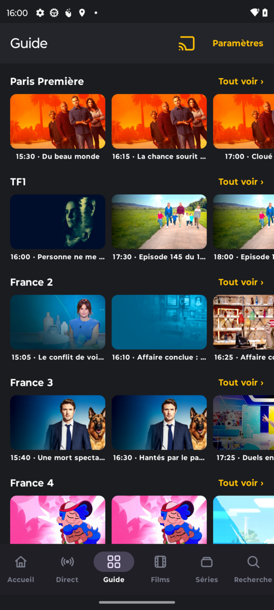
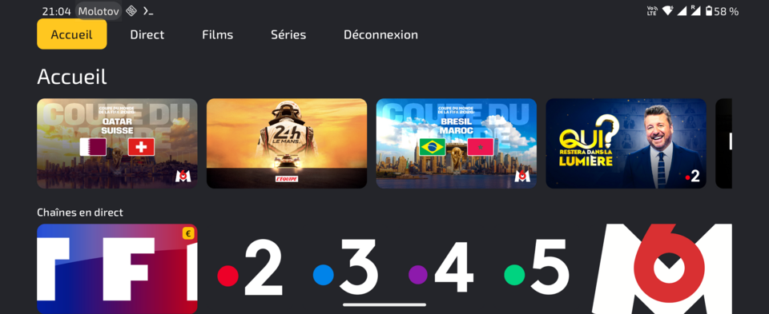

<div align="center">


[](LICENSE)
-3DDC84?logo=android&logoColor=white)


[](https://github.com/renaudallard/etincelle/releases)
[](https://www.paypal.me/RenaudAllard)

</div>

Application Android native (ciblant **Android 16 / API 36**) pour regarder **Molotov** via le
backend **Fubo** qu'utilise l'application Molotov actuelle (5.51), avec l'apparence de l'ancienne
interface Molotov **4.27**. Elle fonctionne sur **téléphone/tablette** et **Android TV**, et lit les
contenus directement sur l'appareil avec le **DRM Widevine** via AndroidX Media3.

Elle donne accès au **direct**, au **guide des programmes** (EPG), à la **recherche**, au
**rattrapage** et à la **VOD**. Le **direct** se **rembobine** : la barre de progression du lecteur
épouse le **programme en cours** (du début à la fin de sa diffusion, heures de début et de fin
affichées à ses extrémités), le bord du direct se situant en
cours de route et la portion pas encore diffusée formant la fin de la barre ; la partie trop ancienne
pour être rembobinée y est tracée dans une couleur distincte, et un bouton **Revenir au direct**
apparaît dès que l'on s'éloigne du bord pour y ramener d'un appui (sur le téléviseur, il s'affiche
avec les commandes du lecteur et s'atteint avec la flèche **Haut**). Cliquer sur un programme ouvre d'abord sa **fiche détaillée**
(synopsis, casting, année, classification) plutôt que de le lire aussitôt, et la fiche regroupe ses
autres diffusions disponibles. Comme dans l'application officielle, la fiche indique au-dessus du titre
quand le programme a été **diffusé** (« Diffusé: 12 févr. ») ou jusqu'à quand il reste disponible
(« Expire dans 6j ») et chaque épisode de la liste sa date de diffusion (« 07 juin à 13h25 »). Les
vignettes portent les mêmes indications que dans l'application officielle : sous le titre, l'épisode
(« S16 E6 Agde »), la durée et l'année (« 52m • 2026 ») ou le nombre d'épisodes enregistrés, et sur
l'image l'étiquette du programme (**REC** pour un enregistrement, l'heure de diffusion pour *Ce soir*) ; sur le téléviseur, l'image du programme en occupe le fond, comme dans
l'application officielle. Pour une chaîne en **direct**, la fiche propose, à côté de **Regarder
en direct**, un bouton **Regarder depuis le début** qui reprend le programme en
cours à son commencement (dans la limite de la fenêtre de rembobinage) : celui que le guide indique,
l'heure affichée sur la fiche, et non l'horaire prévu, qu'un programme en retard ne tient pas, un bouton **Regarder le
replay** quand ce même programme est aussi disponible à la demande, qui le lit alors en entier depuis
sa première minute, et un menu **Enregistrer** pour
enregistrer soit **l'épisode** en cours, soit **la série** entière. Quand un programme fait partie d'une série en rattrapage, sa fiche
liste en dessous les **épisodes disponibles** (avec leur vignette) pour en choisir un autre ; pour une
série **enregistrée**, elle affiche d'abord vos épisodes enregistrés (lus depuis le DVR), puis la même
liste des **épisodes disponibles** en rattrapage. À la fin d'un épisode, l'**épisode suivant**
s'annonce par un compte à rebours (« Commence dans 9 s ») puis démarre tout seul, sur le téléphone comme
sur le Chromecast pendant une diffusion, y compris l'application en arrière-plan ; **À suivre** le
lance aussitôt et **Regarder le générique** laisse l'épisode se terminer. Un épisode regardé jusqu'au
générique reprend ensuite depuis le début. Un programme **pas encore diffusé** indique quand il
passera (par exemple « Ce programme sera en direct dans 4 jours. ») au lieu d'un « Regarder » qui
échouerait. La fiche d'une **série** offre un bouton **Enregistrer la série** (qui devient **Arrêter
d'enregistrer la série** une fois l'enregistrement programmé) ; vous retrouvez vos
**enregistrements** (DVR) dans l'onglet **Enregistrements** (« Enregistrés » sur téléphone), en grille
comme dans l'application officielle : une vignette par série indique son nombre d'épisodes et ouvre la
liste des épisodes enregistrés, avec leur date d'enregistrement. Un enregistrement se lit depuis le
DVR où qu'on l'ouvre (onglet, rangées *Vos enregistrements* de l'accueil, des films et des séries, fiche
d'une série). Les contenus à la demande
(rattrapage, VOD, enregistrements) sont mis en **mémoire tampon** plus loin à l'avance, selon la
mémoire de l'appareil, pour qu'une brève coupure réseau n'interrompe pas la lecture. L'accueil réunit aussi les
**applications des diffuseurs** (france.tv, MyTF1, M6+…) : ouvrez l'une d'elles pour parcourir son
catalogue (un abonnement peut être requis). Cliquer sur l'en-tête d'une rangée (par ex. *En direct à
la TV*) ouvre la **catégorie complète en grille**, avec le nom de la chaîne sous chaque programme.
Dans la **recherche**, **Tout voir** sur une rangée de résultats (chaînes, programmes) les affiche
tous en grille. Un même programme proposé sur plusieurs chaînes n'y apparaît qu'une fois, de
préférence sur une chaîne incluse dans votre abonnement, avec le logo de la chaîne sur la vignette, et
le nombre affiché en tête de rangée en tient compte. Une recherche sans résultat l'indique par
« Aucun résultat trouvé », et sur téléphone le clavier se ferme dès la recherche lancée pour laisser
voir les résultats.
La grille de **toutes les chaînes** (TNT, chaînes thématiques Molotov…) s'ouvre avec l'onglet
**Chaînes** sur la TV, et sur téléphone avec **Tout voir** de la rangée *Chaînes en direct* de
l'accueil (sa place dans la barre du bas revient aux enregistrements), pour les parcourir directement ; ouvrir une chaîne propose son **direct** ainsi que ses **replays** et
ses programmes **les plus vus**. Les **chaînes favorites** ouvrent cette grille, dans l'ordre que vous
choisissez : sur téléphone, l'**étoile** d'une chaîne l'ajoute aux favoris ou l'en retire, et l'étoile
de la barre du haut ouvre **Réorganiser les favoris** (▲ et ▼ déplacent une chaîne) ; sur la TV, un
**appui long sur OK** fait de même, et le bouton **Réorganiser les favoris** permet de saisir une
chaîne avec OK puis de la déplacer avec Haut et Bas. Le **guide** couvre toutes les chaînes de l'offre sur 24 heures et se rafraîchit à chaque ouverture.
Ce qui passe **en ce moment** se périme avec l'heure : le guide et toute page qui montre des
programmes en direct (l'accueil, **Direct**, les rangées « En direct ») se rechargent d'eux-mêmes,
sans perdre la position dans la liste : toutes les 5 minutes tant qu'ils restent à l'écran, et dès
que l'on y revient (retour dans l'application, sortie d'une fiche ou du lecteur) s'ils ont plus de
2 minutes. Sur téléphone, n'importe quelle page se **rafraîchit** aussi en tirant au-delà du haut ou
du bas de la liste.

L'application accepte aussi des **liens profonds** vers une fiche, pour l'intégration par des
applications tierces (par ex. [multistream](https://github.com/renaudallard/multistream)) :
`etincelle://series/{id}`, `etincelle://program/{id}` ou `etincelle://channel/{id}` (identifiants Fubo).

Les **profils** du compte sont pris en charge : avec plusieurs profils, etincelle demande **Qui
regarde ?** au démarrage, comme l'application officielle (quand le choix date de plus de deux jours
ou que les profils ont changé). **Profils**, dans les paramètres, permet de changer de profil, d'en
**ajouter** (jusqu'à la limite du compte), et avec **Modifier** de renommer un profil, de changer
son avatar ou de le supprimer. Les chaînes favorites et l'accueil suivent le profil choisi.

Elle ajoute un **sélecteur de saison** sur les séries qui en comptent plusieurs, et des **icônes de
genre** dans les grilles de catégories. Les vignettes portent le **logo de la chaîne** qui propose le
programme (directs, résultats de recherche…), comme dans l'application officielle, et gardent la
forme de leur image : affiches en portrait, images en paysage, logos de chaînes sur un carré. Sur téléphone, un
menu **Paramètres**, ouvert par l'engrenage de la
barre du haut, regroupe les réglages : les **profils**, le nombre de **vignettes par ligne** des
grilles, le **masquage des contenus verrouillés** (cache les programmes non inclus dans votre
abonnement), le choix d'une **icône monochrome** (logo blanc), l'activation expérimentale du
**récepteur Cast Fubo officiel** (redémarrage requis), **Connecter une TV** (voir plus bas), un bouton
**Vérifier les mises à jour** (compare la version installée à la dernière publiée sur GitHub) et la
**déconnexion** (avec confirmation). Sur Android TV, l'onglet **Paramètres** propose la déconnexion,
les profils, l'autorisation de réveil par le téléphone (voir plus bas) et le nombre de vignettes par
ligne. Sur
téléphone, vous pouvez **diffuser** le flux en cours vers un **Chromecast** et transférer la lecture
d'un appareil à l'autre. Si le direct a été **rembobiné** avant la diffusion, le Chromecast reprend au
même endroit dans le différé plutôt qu'au bord du direct. Une **coupure Wi-Fi** passagère du téléphone n'arrête pas
la diffusion : le téléphone reprend la main sur le Chromecast, qui joue sans interruption. Un programme diffusé garde son **point de reprise** sur le
téléphone, même arrêté depuis le téléviseur : il reprend ensuite là où la diffusion s'est arrêtée. Le **programme en cours** est aussi repéré
sur la barre du téléviseur pendant la diffusion. Pendant la diffusion, l'application **reste sur la fiche du programme** : une
**barre persistante** en bas de l'écran affiche l'appareil, avec une animation du logo Chromecast qui
se remplit jusqu'à ce que la lecture démarre réellement sur la TV. **Touchez cette barre** pour
ouvrir les **commandes de lecture** (lecture/pause, retour et avance, barre de progression) qui
pilotent la diffusion ; le retour arrière revient à la navigation sans interrompre la diffusion. Les
**boutons de volume** du téléphone règlent alors le volume du Chromecast (un indicateur s'affiche
brièvement). Côté Chromecast, les contenus à la demande sont eux aussi mis en mémoire tampon plus
loin à l'avance pour absorber les coupures réseau. La diffusion
s'appuie sur un récepteur Cast Widevine personnalisé, hébergé séparément :
[etincelle_receiver](https://github.com/renaudallard/etincelle_receiver).
Certains téléphones cessent de trouver les Chromecast par les services Google, jusqu'à ce que l'on
coupe puis rallume le Wi-Fi. etincelle cherche donc aussi les Chromecast **par lui-même** sur le
réseau Wi-Fi et ajoute ceux que les services Google ne voient pas à la liste ; si les services
Google affichent un Chromecast sans parvenir à s'y connecter, etincelle s'y connecte lui-même. Ce
qu'il a trouvé ainsi, applications TV comprises, quitte la liste dès que le téléphone n'est plus sur
ce réseau Wi-Fi. La
diffusion vers un tel Chromecast passe par une **connexion directe** : le Chromecast doit d'abord
prouver qu'il est un
appareil Cast authentique (certificat signé par Google, et non révoqué) avant de recevoir quoi que ce soit, puis
tout fonctionne comme d'habitude, commandes de lecture, barre du programme en cours, retour au
direct, volume, passage d'un Chromecast à l'autre et retour sur le téléphone. Si la connexion est
coupée, etincelle se reconnecte au Chromecast sans interrompre la lecture. La notification de
lecture d'etincelle (voir plus bas) pilote alors le Chromecast.

Le téléphone peut aussi **piloter l'application TV d'etincelle**, comme un Chromecast mais avec la
télécommande d'etincelle elle-même : elle
apparaît dans la liste **Lire sur** sous le nom du téléviseur suivi de « (appli TV) », les Chromecast
y portant « (Chromecast) » puisqu'ils ont souvent le même nom, et l'on choisit
laquelle quand il y en a plusieurs. La liste est cherchée de nouveau tant qu'elle est ouverte, même
pendant une diffusion. Le téléviseur lit alors ce que l'on choisit sur le téléphone
(direct, rattrapage, enregistrement) avec sa propre connexion, enchaîne lui-même l'épisode suivant,
et se pilote depuis la barre de diffusion, la notification ou les touches de volume du téléphone.
Toucher la barre de diffusion ouvre une **télécommande** : ce qui passe, lecture/pause, recul de
10 s, avance de 30 s, et les flèches, OK et Retour pour naviguer dans l'application TV. Seul un
téléphone connecté au **même compte** Molotov peut piloter le téléviseur, et réciproquement : chacun
le prouve à l'autre à partir du compte, sans que la télécommande n'envoie le moindre identifiant sur
le réseau local, et leurs échanges sont chiffrés. Le téléphone et le téléviseur doivent utiliser la
même version du protocole : mettez à jour les deux applications ensemble.

L'application TV peut rester joignable **à tout moment**, comme un Chromecast : ouverte ou non, derrière
l'économiseur d'écran ou une autre application, téléviseur en veille s'il garde alors sa connexion au
réseau (c'est le cas d'un Chromecast avec Google TV), et cela dès le démarrage du téléviseur. Une lecture lancée depuis le téléphone, ou une touche de sa télécommande, ouvre alors
etincelle et réveille le téléviseur. Il faut pour cela l'y autoriser, une seule fois : dans ses
**Paramètres**, **Laisser le téléphone trouver et réveiller ce téléviseur à tout moment** ouvre la page
système où l'autoriser à se superposer aux autres applications. Sans cette autorisation, elle n'est
joignable que lorsqu'elle est à l'écran ou derrière l'**économiseur d'écran**, et la lecture demandée
démarre dès que l'on réveille le téléviseur avec sa télécommande.

Sur téléphone, la **lecture continue en arrière-plan** et écran verrouillé (le son seul, la vidéo
reprenant au retour dans l'application), avec une **notification de lecture** et des **commandes sur
l'écran de verrouillage** : lecture/pause, recul de 10 s et avance de 30 s. Elles pilotent le
téléphone, ou le Chromecast pendant une diffusion, direct compris (dans la limite de la fenêtre de
rembobinage), comme les boutons de la télécommande plein écran qui s'ouvre en touchant la barre de
diffusion. Toucher la notification ramène dans l'application. Si l'application est relancée pendant
une diffusion passant par les services Google, elle la retrouve et la notification en reprend aussitôt
le titre.

etincelle **vérifie les mises à jour** sur GitHub à chaque démarrage, puis une fois par jour tant
qu'elle reste ouverte, et propose d'installer la dernière version lorsqu'une plus récente est
disponible (l'APK téléphone sur le téléphone, l'APK TV sur la TV). **Installer** la télécharge,
vérifie sa taille et son empreinte SHA-256 publiées par GitHub, puis la confie à l'installateur
d'Android, qui demande confirmation. La première fois, etincelle ouvre la page des paramètres où
l'autoriser à installer des applications ; appuyez ensuite à nouveau sur **Installer**. Sur un
téléviseur qui n'a pas cette page, etincelle ouvre ses paramètres et indique le chemin : **Applications
> Sécurité et restrictions > Sources inconnues**, puis etincelle. Sur le téléviseur, Android ferme
etincelle une fois la mise à jour installée : rouvrez-la depuis l'écran d'accueil.

Avec le réglage **Mises à jour automatiques** (dans **Paramètres**, désactivé par défaut, proposé à
partir d'Android 12), etincelle ne demande plus rien : elle télécharge la nouvelle version en silence et
l'installe quand on quitte l'application alors que rien n'est lu ni diffusé, puisque l'installation
ferme l'application. Sur le téléviseur, l'économiseur d'écran ne compte pas comme quitter
l'application : le téléphone peut toujours la piloter. etincelle doit déjà être autorisée à installer
des applications, ce dont une première mise à jour à la main se charge. Google Play Protect peut
encore afficher sa propre demande pour une version qu'il ne connaît pas ; et si Android réclame
malgré tout une confirmation, ou si l'installation échoue, la version est proposée comme d'habitude
à l'ouverture suivante. **Vérifier les mises à jour** propose toujours l'installation immédiate.

La [politique de confidentialité](PRIVACY.md) dit ce que les applications envoient, et à qui ; elle
s'ouvre aussi depuis **Paramètres**.

> ### ⚠️ Avertissement
>
> Projet non officiel, sans aucune affiliation avec Molotov ni Fubo. **etincelle** n'est qu'un
> client alternatif : il n'offre aucun accès gratuit, ne partage aucun compte et ne contourne aucune
> protection.
>
> - **Aucun contournement de géo-restriction.** L'application n'embarque ni VPN, ni proxy, ni aucun
>   moyen de masquer ou de falsifier votre localisation. Le backend reste géo-restreint à l'Union
>   européenne : hors de l'UE, le service ne fonctionne pas, et etincelle ne vous aidera d'aucune
>   façon à le débloquer.
> - **Aucun accès sans compte.** Regarder Molotov exige votre propre compte payant valide avec
>   l'option **Molotov Extra** sur Fubo. L'application ne fournit aucun identifiant et ne permet
>   strictement pas de regarder Molotov sans cet abonnement.
>
> Vous restez seul responsable du respect des conditions d'utilisation de Molotov/Fubo et de la
> législation applicable.

## Captures d'écran

Téléphone (Jetpack Compose, Material 3) :

<p align="center">
  
  
  
</p>

Android TV (Compose for TV, navigation D-pad) :

<p align="center">
  
</p>

Sur Android TV, la connexion se fait par **code** plutôt qu'en tapant un mot de passe à la
télécommande : le téléviseur affiche un **QR code** et un code à six chiffres. Sur votre téléphone,
ouvrez etincelle, allez dans **Paramètres > Connecter une TV** (ou sur molotov.tv/tv), connectez-vous
et saisissez le code : le téléviseur se connecte automatiquement. La connexion par email reste
disponible en secours.

Sur Android TV, une lecture qu'une erreur interrompt (adresse du flux périmée, coupure du réseau)
reprend d'elle-même là où elle en était, y compris dans un direct rembobiné, en redemandant le flux.
Après cinq échecs de suite, le lecteur se ferme et la page d'où il a été lancé affiche « Lecture
impossible, réessayez ».

Sur Android TV, etincelle publie aussi une rangée **etincelle** de programmes recommandés sur
l'écran d'accueil et place les programmes commencés dans **Continuer à regarder** (Watch Next), à
partir des listes de Molotov. Elles se mettent à jour toutes les trois heures, et à chaque ouverture
ou fermeture de l'application ; choisir un programme ouvre sa fiche. L'écran d'accueil Android TV
classique les affiche ; le lanceur Google TV n'affiche pas les rangées des applications et, sur le
Chromecast avec Google TV essayé, refuse les entrées de Watch Next.

etincelle est aussi une **entrée TV** du système : ses chaînes Molotov, avec douze heures de
programmes, rejoignent le **guide des chaînes** d'Android TV (l'onglet Direct de Google TV, là où il
existe, ou l'application Chaînes en direct), et etincelle les lit elle-même quand on en choisit une.
Le guide se met à jour au plus toutes les trois heures ; dans les paramètres du téléviseur
(**Chaînes et entrées**), l'entrée etincelle ajoute les chaînes à la demande.

Un compte protégé par la **validation en deux étapes** se connecte comme dans l'application
officielle : après l'email et le mot de passe, etincelle demande le **code** envoyé par Molotov,
avec **Renvoyer le code** s'il n'arrive pas.

## Installation

Téléchargez l'APK signé pour votre appareil depuis la
[dernière version](https://github.com/renaudallard/etincelle/releases/latest) :

- **Téléphone / tablette** : `etincelle-<version>-mobile.apk`
- **Android TV** : `etincelle-<version>-tv.apk`

Les deux fonctionnent sur Android 6.0+ (`minSdk 23`) et sont auto-signés, donc Android vous demande
d'autoriser l'installation depuis une source inconnue. La connexion nécessite un compte payant
**Molotov Extra** sur Fubo et une connexion depuis l'UE.

**Téléphone / tablette**

1. Téléchargez `etincelle-<version>-mobile.apk` sur l'appareil, ou installez-le par USB avec
   `adb install etincelle-<version>-mobile.apk`.
2. Autorisez « Installer des applications inconnues » pour votre navigateur ou gestionnaire de
   fichiers si demandé.
3. Ouvrez **etincelle** et connectez-vous.

**Android TV** (pas de navigateur, à charger en sideload)

- Par adb : `adb connect <ip-tv>` puis `adb install etincelle-<version>-tv.apk`, ou
- copiez l'APK sur une clé USB, ou poussez-le avec un utilitaire de sideload (par ex. *Send files to
  TV*, *Downloader*), puis ouvrez-le.

Les builds téléphone et TV sont des paquets distincts (`it.allard.etincelle` et
`it.allard.etincelle.tv`), vous pouvez donc installer les deux côte à côte. Pour construire les APK
vous-même, voir [Construction](#construction) ci-dessous.

## Architecture du projet

```
etincelle/
├── app-mobile/             application téléphone/tablette (Compose, Material3, Media3)
├── app-tv/                 application Android TV (Compose for TV, navigation + lecture au D-pad)
├── core/
│   ├── designsystem/       jetons du thème sombre Molotov-4.27 + composants + icônes de genre
│   ├── model/              types métier en Kotlin pur (PlaybackSource, DrmSpec, UserSession)
│   ├── domain/             l'interface MolotovRepository (abstraction du backend)
│   ├── network/            OkHttp/Retrofit/Moshi + intercepteurs Fubo + session + TokenStore
│   ├── player/             mapping Media3 : DrmSpec vers MediaItem Widevine
│   ├── cast/               diffusion Chromecast Widevine, par Play Services ou en direct (téléphone)
│   ├── remote/             télécommande de l'application TV : découverte, poignée de main, messages
│   └── ui/                 MainViewModel/UiState partagés + vérif. de mise à jour GitHub
├── data/
│   └── fubo/               FuboRepository (implémente MolotovRepository) + DTO/mappers + DI
└── gradle/libs.versions.toml   catalogue de versions
```

Les deux applications affichent le même catalogue `papi` et lisent les mêmes flux ; seule la couche UI
Compose diffère (Material3 + barre inférieure sur téléphone, lignes Compose-for-TV + focus D-pad sur
TV). La couche de présentation (`core:ui`) ne dépend que de l'interface `MolotovRepository` de
`core:domain`, le backend reste donc interchangeable. Les tests unitaires couvrent les intercepteurs,
les mappers DTO vers métier/DRM, le rafraîchissement des jetons, la logique de lecture (points de
reprise, direct, mémoire tampon, épisode suivant), la recherche et l'authentification des Chromecast,
le protocole de la télécommande TV, la vérification des mises à jour et le `MainViewModel`. L'injection de dépendances est un
petit `AppContainer` manuel (Hilt serait surdimensionné pour une application à un seul ViewModel et un
seul backend ; il pourra être ajouté si le graphe grandit).

## Construction

Prérequis sur la machine de build :

- Android SDK avec `platforms;android-36` et `build-tools;36.0.0`
  (`sdkmanager "platforms;android-36" "build-tools;36.0.0"`).
- **JDK 21** pour Gradle (AGP 8.x ne supporte pas le JDK 25). Le JDK du daemon Gradle est fixé dans
  `gradle.properties` via `org.gradle.java.home` ; adaptez le chemin à votre machine.
- Le wrapper Gradle (Gradle 8.x) est versionné ; utilisez `./gradlew`, pas un Gradle système.

```bash
./gradlew :app-mobile:assembleGithubDebug      # APK debug téléphone/tablette
./gradlew :app-tv:assembleGithubDebug          # APK debug Android TV
```

Chaque application existe en deux variantes. **github** est celle des versions publiées sur GitHub :
elle vérifie et installe elle-même ses mises à jour. **play** est destinée à Google Play, qui met
lui-même ses applications à jour et interdit qu'elles le fassent autrement : elle n'a ni la
vérification des mises à jour, ni le réglage **Mises à jour automatiques**, ni les permissions
d'installation (`:app-mobile:bundlePlayRelease`, `:app-tv:bundlePlayRelease`). Les deux variantes
portent le même identifiant et la même signature.

Indiquez l'emplacement du SDK dans `local.properties` (`sdk.dir=/chemin/vers/Android/Sdk`).

## Chaîne d'outils

Kotlin 2.4, AGP 8.12, Gradle 8.14, Jetpack Compose (BOM 2025.06), Compose for TV (`androidx.tv`),
AndroidX Media3 1.7. `compileSdk`/`targetSdk` = 36, `minSdk` = 23.

## Licence

BSD 2-Clause. Voir [LICENSE](LICENSE).
